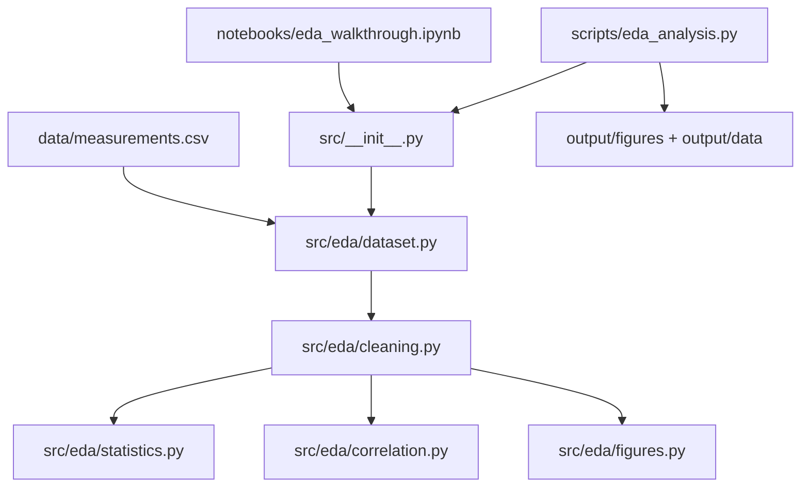

# EDA Notebook — Exploratory Data Analysis Exemplar

A computational-notebook exemplar: an interactive walkthrough notebook
([`notebooks/eda_walkthrough.ipynb`](notebooks/eda_walkthrough.ipynb)) that
imports a small, fully-tested EDA library instead of carrying logic in its
cells. Exemplar roster:
[`projects/AGENTS.md`](https://github.com/docxology/template/blob/main/projects/AGENTS.md#permanent-canonical-exemplars).

> **Standalone mirror.** This repository is published from
> `projects/templates/template_eda_notebook/` in the
> [template monorepo](https://github.com/docxology/template). Commands and paths
> below that mention `projects/templates/...`, `scripts/pipeline/*`, or
> `scripts/audit/*` run from a monorepo checkout, not from this repo. `src/` is
> infrastructure-free; `scripts/eda_analysis.py` imports the monorepo's
> `infrastructure` package.

Start with the [documentation index](docs/README.md) and [quickstart](docs/quickstart.md).

## When to use this template

Use this template for **exploratory data analysis on tabular data**: load a
dataset, surface missingness, compute descriptive statistics and per-group
means, rank features by correlation, and produce a few diagnostic figures. It is
a demonstration of the **notebook -> tested src extraction**
workflow: explore fast in a notebook cell, then move any computation that
matters into `src/eda/` behind a failing test (thin-orchestrator pattern;
`src/` implements, scripts and cells coordinate, tests enforce ≥90% coverage
with no mocks). If your project is primarily prose, layout, or numerical
optimization, see
[`template_prose_project`](https://github.com/docxology/template/tree/main/projects/templates/template_prose_project),
[`template_newspaper`](https://github.com/docxology/template/tree/main/projects/templates/template_newspaper),
or
[`template_code_project`](https://github.com/docxology/template/tree/main/projects/templates/template_code_project)
instead.

## Publication and rendering

The publishing metadata and per-platform status below are **compiled from
`docs/manuscript/config.yaml`** by `infrastructure.publishing.status_report` — do not
hand-edit between the markers. From the pinned runner root with `project` set
as in the quickstart, use:

```sh
uv run python -m infrastructure.publishing.status_report --project "$project" \
  --config "$project/docs/manuscript/config.yaml" --write
```

The pinned status generator still prints the former path in its legend.
Use the explicit `--config` path above for this checkout.

<!-- PUBLISHING-STATUS:START (generated by infrastructure.publishing.status_report) -->
**Exploratory Data Analysis: A Reproducible Notebook Template** · v1.0.0 · MIT · Daniel Ari Friedman

Concept DOI: [10.5281/zenodo.21086292](https://doi.org/10.5281/zenodo.21086292) | Version DOI: [10.5281/zenodo.21086293](https://zenodo.org/records/21086293) | Repository: [docxology/template_eda_notebook](https://github.com/docxology/template_eda_notebook)

Publishing surface — 20 platforms, 9 published:

| Platform | Tier | Status | Reference | Credentials |
| --- | --- | --- | --- | --- |
| zenodo | first-class | ✅ published | [10.5281/zenodo.21086292](https://doi.org/10.5281/zenodo.21086292) | `ZENODO_API_TOKEN` |
| github | first-class | ✅ published | [docxology/template_eda_notebook](https://github.com/docxology/template_eda_notebook) | `GITHUB_TOKEN` |
| arxiv | first-class | ⚪ available | — | — |
| pypi | first-class | ✅ published | [https://test.pypi.org/project/template-eda-notebook/1.0.0/](https://test.pypi.org/project/template-eda-notebook/1.0.0/) | `PYPI_TOKEN`, `TESTPYPI_TOKEN` |
| ipfs_pinata | first-class | ✅ published | [https://gateway.pinata.cloud/ipfs/QmSsHhWo2JC76gQSy6rQuN6uKTP1gH9vtj3kGKLgY5oU4E](https://gateway.pinata.cloud/ipfs/QmSsHhWo2JC76gQSy6rQuN6uKTP1gH9vtj3kGKLgY5oU4E) | `PINATA_JWT` |
| ipfs_web3storage | first-class | ⚪ available | — | `WEB3_STORAGE_TOKEN` |
| software_heritage | first-class | ✅ published | [https://archive.softwareheritage.org/browse/origin/?origin_url=https://github.com/docxology/template_eda_notebook](https://archive.softwareheritage.org/browse/origin/?origin_url=https://github.com/docxology/template_eda_notebook) | — |
| github_pages | first-class | ✅ published | [https://docxology.github.io/template_eda_notebook/](https://docxology.github.io/template_eda_notebook/) | `GITHUB_TOKEN` |
| cloudflare_pages | first-class | ⚪ available | — | `CLOUDFLARE_API_TOKEN` |
| netlify | first-class | ✅ published | [https://6a444920f59418acc0357e9f--tranquil-kleicha-0c9203.netlify.app](https://6a444920f59418acc0357e9f--tranquil-kleicha-0c9203.netlify.app) | `NETLIFY_AUTH_TOKEN` |
| huggingface_hub | first-class | ✅ published | [https://huggingface.co/datasets/ActiveInference/template_eda_notebook](https://huggingface.co/datasets/ActiveInference/template_eda_notebook) | `HUGGINGFACE_TOKEN`, `HF_TOKEN` |
| osf | first-class | ✅ published | [https://osf.io/ycwsk/](https://osf.io/ycwsk/) | `OSF_TOKEN` |
| amazon_kdp | documented | 🟡 planned | — | `AMAZON_KDP_EMAIL`, `AMAZON_KDP_PASSWORD` |
| google_play_books | documented | 🟡 planned | — | `GOOGLE_PLAY_BOOKS_SERVICE_ACCOUNT_JSON` |
| gumroad | documented | 🟡 planned | — | `GUMROAD_ACCESS_TOKEN` |
| leanpub | documented | 🟡 planned | — | `LEANPUB_API_KEY` |
| lulu | documented | 🟡 planned | — | `LULU_CLIENT_KEY`, `LULU_CLIENT_SECRET` |
| draft2digital | documented | 🟡 planned | — | `DRAFT2DIGITAL_API_TOKEN` |
| stripe | documented | 🟡 planned | — | `STRIPE_SECRET_KEY`, `STRIPE_PUBLISHABLE_KEY` |
| ingramspark | documented | 🟡 planned | — | `INGRAMSPARK_CLIENT_ID`, `INGRAMSPARK_CLIENT_SECRET` |

_Keywords: exploratory data analysis, computational notebook, reproducible research, pandas, data cleaning, correlation analysis._

_Status legend: ✅ published (durable identifier recorded in `config.yaml`) · 🔵 reserved (identifier reserved but not yet registered by final publication) · ⚪ available (adapter implemented and locally verifiable) · 🟡 planned. This block is generated — edit `docs/manuscript/config.yaml`, then use the regeneration command above._
<!-- PUBLISHING-STATUS:END -->

The 3 platforms still shown ⚪ available are not automatable to "published" with
current tooling/credentials, not an oversight: **arXiv** has no submission API
in this codebase (`infrastructure.publishing.arxiv` only prepares a local
tarball — a human must upload it via arxiv.org and the resulting `arxiv` URL
would then be added to `publication.published_artifacts`); **Cloudflare
Pages** needs a `CLOUDFLARE_ACCOUNT_ID` the configured API token cannot
auto-discover; **IPFS (Web3.Storage)** has no `WEB3_STORAGE_TOKEN` configured.

The tracked [output snapshot](output/) records the published EDA example.
[Build this checkout with the pinned runner](docs/quickstart.md) to regenerate
the analysis, PDF, HTML, and slide decks from its current sources.

## Configuration

`docs/manuscript/config.yaml` is the configuration source of truth (paper metadata,
publication block, and the dataset schema); copy
[`docs/manuscript/config.yaml.example`](docs/manuscript/config.yaml.example) to start a new
project. The dataset column roles are also declared in code at
`src/eda/dataset.py::DatasetSchema`. No absolute paths are hardcoded — the
shipped CSV resolves relative to the project root.

## Key features

- **Deterministic dataset**: `data/measurements.csv` is a static, committed
  fixture (fixed content, no generator step at run time), so every statistic
  is reproducible.
- **Tested EDA library** (`src/eda/`): `load_dataset`, `clean_dataset`,
  `normalize_numeric`, `summary_statistics`, `group_means`, `correlation_matrix`,
  `strongest_pairs`, and figure-data preparers.
- **Walkthrough notebook**: imports the library and walks the EDA; cells carry no
  logic (enforced by `tests/test_notebook.py`).
- **Thin analysis script**: `scripts/eda_analysis.py` runs the pipeline headless
  and writes figures + a summary CSV.

## Architecture



## Research overlays

- [`domain_profile.yaml`](domain_profile.yaml) — the `eda_notebook` domain,
  outputs, review gates, source policy, and artifact expectations.
- [`experiment_plan.yaml`](experiment_plan.yaml) — raw / cleaned / normalized
  conditions, primary metric, expected figures and tables, baseline, ablation.
- [`data/claim_ledger.yaml`](data/claim_ledger.yaml) — manuscript numeric claims
  sourced from code/artifacts.

These files are validation inputs only; they do not run autonomous agents.

## More information

See [AGENTS.md](AGENTS.md) for technical documentation and
[`src/AGENTS.md`](src/AGENTS.md) for the library API.

## Template integrity (fork / standalone)

- Forward backlog: [`TODO.md`](docs/TODO.md).
- Standalone fork guide: [`STANDALONE.md`](STANDALONE.md).
- Copy-and-customize config: [`docs/manuscript/config.yaml.example`](docs/manuscript/config.yaml.example).
- Project validation: use the test and coverage command in the [pinned quick start](docs/quickstart.md#register-the-checkout-and-run-the-tests).
- Repo drift validation: `uv run python scripts/audit/check_template_drift.py --strict`.
