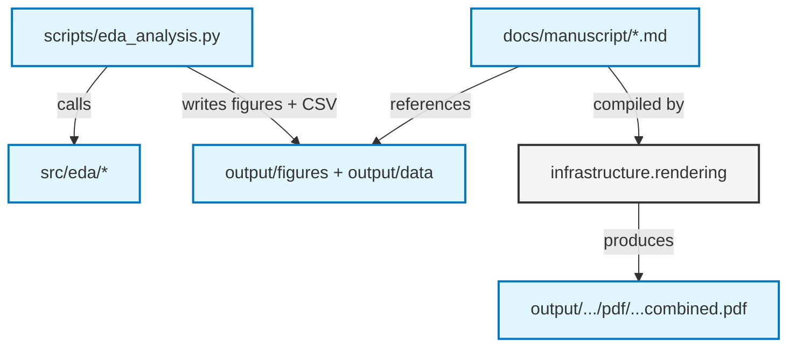

# `template_eda_notebook` — Manuscript

The manuscript for the exploratory-data-analysis exemplar. It describes the EDA
workflow in prose and references the figures and summary table produced by the
thin analysis script — every claim traces to a tested function in `src/eda/`.

## Manuscript Structure

The `docs/manuscript/` directory contains the raw markdown the renderer
(`infrastructure/rendering/pdf_renderer.py`) transforms into the final PDF:

- [`00_abstract.md`](00_abstract.md) — Abstract — the EDA archetype and the headline finding.
- [`01_introduction.md`](01_introduction.md) — Why EDA; the notebook -> tested src extraction idea.
- [`02_methodology.md`](02_methodology.md) — Dataset, cleaning, statistics, correlation, figure data.
- [`03_results.md`](03_results.md) — The EDA figures and the summary-statistics table.
- [`04_conclusion.md`](04_conclusion.md) — What the workflow guarantees.
- [`05_experimental_setup.md`](05_experimental_setup.md) — Dataset schema, environment, reproduction commands.
- [`06_reproducibility.md`](06_reproducibility.md) — Artifact inventory and regeneration commands.
- [`07_scope_and_related_work.md`](07_scope_and_related_work.md) — Scope limits and related EDA literature.

- [References](99_references.md) and [bibliography](references.bib)

## Architecture

## Build

Use the [pinned quickstart](../quickstart.md) to generate the figures and render the paper.

## AI Agent Directives

If you are an AI agent operating in this repository, read [`AGENTS.md`](AGENTS.md)
before editing — it defines the zero-mock testing constraints and the
figure protocol.

## See also

- [`SYNTAX.md`](SYNTAX.md) — Pandoc citation / cross-reference conventions.
- [`docs/guides/manuscript-semantics.md`](https://github.com/docxology/template/blob/main/docs/guides/manuscript-semantics.md) — Repository-wide manuscript semantics.
- [`projects/AGENTS.md`](https://github.com/docxology/template/blob/main/projects/AGENTS.md#permanent-canonical-exemplars) — public exemplar roster.
